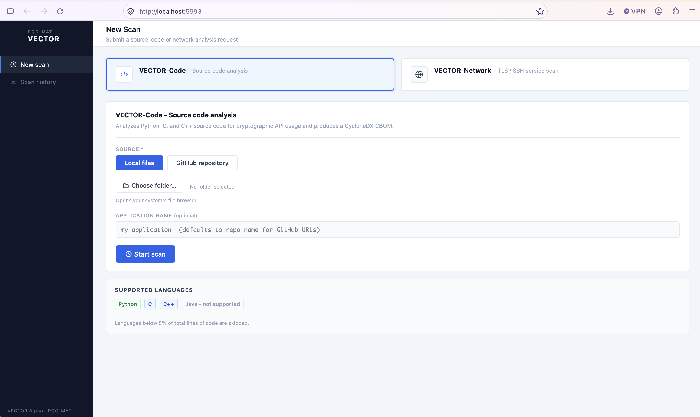
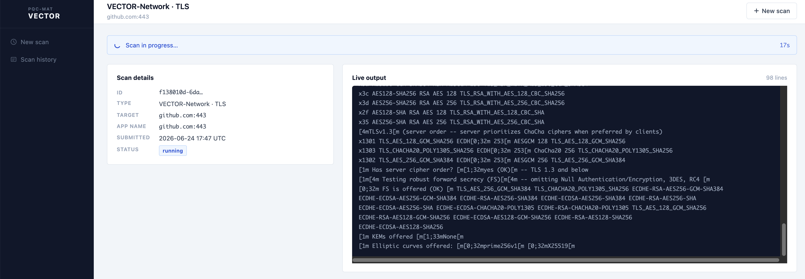

# Quick start

VECTOR can be run in two ways:

| | Requires | Usage | Recommended for |
|---|---|---|---|
| **Standalone container** | Docker engine | One-off scans, CI/CD pipelines, the web GUI | End users and automation engineers |
| **Dev Container** | Docker engine + VS Code + Dev Containers extension | Interactive development, exploring output | Developers |

> **Note:** CodeQL requires an x86_64 host. VECTOR-Code does not run on ARM-based machines.

---

## 1. Start VECTOR

### Standalone container — `vector.sh`

Run from the repository root:

```bash
chmod +x vector.sh   # first time only
./vector.sh          # start the web GUI (same as ./vector.sh gui)
./vector.sh cli      # show the vector CLI help
./vector.sh build    # rebuild the image after a code change
./vector.sh help | -h    # full command reference
```

The image is built automatically only on first use; to rebuild afterwards, run `./vector.sh build`.

### Dev Container

In VS Code: Command Palette → `Dev Containers: Reopen in Container`; all tools are installed automatically. Then, enter the dev environment from the container terminal with

```
poetry shell
```

---

## 2. Run a scan from the command line

The same commands work in both modes; only the prefix and the meaning of paths differ:

| Form | Where it runs | Paths refer to |
|---|---|---|
| `vector <command> ...` | Dev Container terminal | The container filesystem |
| `./vector.sh cli <command> ...` | Host terminal (runs the standalone container) | The host filesystem (source and `--output` directories are mounted into the container) |


> **NOTE:** With `./vector.sh`, results are written to `./output` in the current directory unless `--output <dir>` is given. A directory passed to `--output` must already exist.

### VECTOR-Code
Run a scan of the demo project ([pyca/cryptography](https://github.com/pyca/cryptography)) bundled in the image; use the container path as-is with `vector code`, or the `demo` keyword with `./vector.sh`.

```bash
./vector.sh cli code demo --output results                           # standalone
vector code /home/vector/test-project/cryptography --output results   # dev container
```

Scan your own project, or a public GitHub repository

```bash
./vector.sh cli code <path-to-project> --name my-app --output results      # standalone container
vector code /mnt/host-home/<path-to-project> --name my-app --output results  # dev container

./vector.sh cli code https://github.com/owner/repo --name my-app --output results
```

`/mnt/host-home` is the VS Code workspace folder on the host; `--output` defaults to `output/` in the current directory.

### VECTOR-Network: TLS or SSH endpoint
```
./vector.sh cli network --protocol tls --target example.com --port 443 --output results
./vector.sh cli network --protocol ssh --target github.com --port 22 --output results
```

### VECTOR-Score: quantum risk scoring of a CBOM
```
./vector.sh cli score results/cbom/crypto-combined-cbom.json
```


### What you get (CLI)

| Command | Output |
|---|---|
| `code` | `<output>/cbom/crypto-<language>-cbom.json` (plus `crypto-combined-cbom.json` for multi-language projects), SARIF results, and CodeQL databases |
| `network` | `<output>/<target>_<protocol>_scan.json` (raw scanner output) and `<output>/<target>_<protocol>_cbom.json` |
| `score` | `<input-file-name>_scored.json` (annotated CBOM) and `<input-file-name>_risk_report.md`, next to the input file |

All CBOMs are CycloneDX 1.6 JSON. See [Understanding CBOM output](./cbom-output.md) for a walkthrough.

---

## 3. Use the web GUI

Launch the GUI with `vector gui [--port <port>]` or `./vector.sh gui [--port <port>]`.

Open `http://localhost:<port>` and select **New Scan**:

- **VECTOR-Code** — choose a local folder with **Choose folder…** (uploaded from your browser), or switch to **GitHub repository** and enter a public URL (append `/tree/<branch>` for a specific branch or tag).

  

- **VECTOR-Network** — choose **TLS** or **SSH**, then enter the target host and port.

  

The scan page streams live output; use **Stop** to cancel a running scan. Completed scans, with their risk report, CBOM explorer, and raw output, are listed under **Scan history**.

The GUI scores each scan automatically. The results can be downloaded as `cbom_<scan-id>_scored.json` (annotated CBOM) and `risk_report_<scan-id>.md`, where `<scan-id>` is the first 8 characters of the scan ID.



---

## Known limitations

- **x86_64 only** — no ARM64 build of the CodeQL CLI exists.
- **Supported languages** — Python, C, and C++. Languages below 5% of total lines of code are skipped.
- **One target per run** — neither VECTOR-Code nor VECTOR-Network scans multiple targets in a single invocation.
- **Public repositories only** — private GitHub repositories requiring authentication are not supported.
- **Network access** — VECTOR-Network must be able to reach the target host and port.

## Further reading

- [VECTOR-Code reference](./vector-code.md)
- [VECTOR-Network reference](./vector-network.md) — including re-generating CBOMs from existing scan files
- [VECTOR-Score reference](./vector-score.md)
- [Troubleshooting](./troubleshooting.md)
