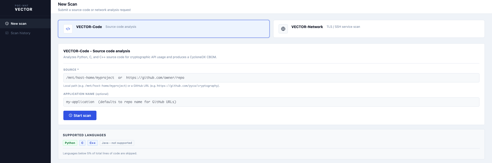
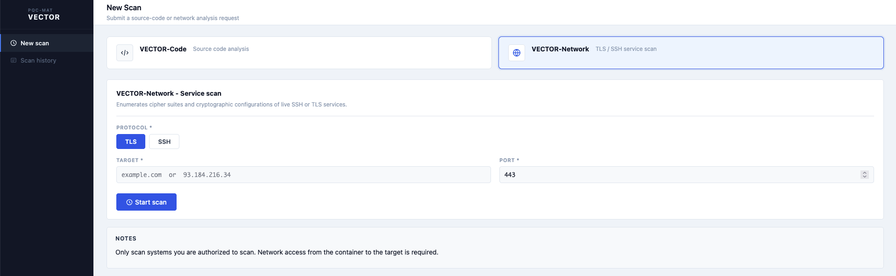

# Quick start

VECTOR can be run in two ways. 

| | Dev Container | Standalone container |
|---|---|---|
| **Requires** | VS Code + Dev Containers extension | Docker only |
| **Used for** | Interactive development, exploring output, the web GUI | One-off scans, CI/CD pipelines, unattended automation |

If you're setting this up in a GitHub Actions / GitLab CI / Jenkins pipeline, or just want to run a scan from a plain terminal without opening VS Code, follow a guideline for [Standalone container](#standalone-container).

---

## Standalone container

The standalone image's entry point is the `vector` CLI directly.

### Using the runner script (recommended)

`vector.sh`, at the repository root, builds the image when needed and starts it in CLI or GUI mode, so there is no need to compose `docker build`/`docker run` invocations by hand. It also checks that any source/output/CBOM path you give it exists on the host *before* starting a container, so a typo or a not-yet-created results folder gives you a clear message instead of a Docker-level permission error.

```bash
chmod +x vector.sh      # first time only

./vector.sh             # start VECTOR GUI (default mode)
./vector.sh cli         # show the vector CLI help
./vector.sh build       # force a rebuild (e.g. after a code change)
```

The image is built automatically the first time `cli` or `gui` is used, if no local image exists yet; it is **not** rebuilt automatically after that. Run `./vector.sh build` explicitly whenever there is a changed code.

Run VECTOR-Code, VECTOR-Network, or VECTOR-Score through the `cli` operation:

```bash
mkdir -p results
./vector.sh cli code <path-to-source-code-folder> --name <app_name> --output results
./vector.sh cli network --protocol <ssh|tls> --target <host> --port <port> --output results
./vector.sh cli score results/cbom/crypto-combined-cbom.json
./vector.sh cli code https://github.com/owner/repo --name my-app --output results
```

For VECTOR GUI, a host directory is made available inside the container by default (your home directory, `$HOME`, mounted read-write at `/mnt/host-home`), so it can be entered as a source path in the web form without any extra setup:

```bash
./vector.sh gui
# insert /mnt/host-home/<path under your home directory> as the source in the web form
```

Use `--source-dir` to mount a different host directory instead (the content of the path becomes the entire content of `/mnt/host-home`), and `--port` to publish on a different local port:

```bash
./vector.sh gui --port 8080 --source-dir ~/projects
# enter /mnt/host-home/<your-project> as the source path in the web form
```

Run `./vector.sh help` for the full command reference.

---

### Equivalent manual commands

#### Building the image

```bash
docker build -t vector -f Dockerfile .
```

#### Usage

1. To extract the resulted files the volume mount to a host directory and `--output` should be pointing to the same directory. The directory should be created and owned by current user first:

```bash
mkdir results
```

2. `vector code`, `vector network` and `vector score` can be run using:

```bash
docker run --rm \
  --user "$(id -u):$(id -g)" \
  -v $(pwd)/results:/output \
  vector <code|network> ... --output /output
```

```bash
docker run --rm \
  --user "$(id -u):$(id -g)" \
  -v $(pwd)/results:/output \
  vector score <cbom_file_path>
```

Results then persist in `results/` on the host after the container exits.

> The results `results/` directory may be any existing directory owned by the current user. The only requirement is that the directory path is correctly specified in the volume mapping, for example: `-v <path_to_folder_owned_by_current_user>:/output`

#### VECTOR-Code

```bash
docker run --rm \
  --user "$(id -u):$(id -g)" \
  -v <path-to-source-code-folder>:/src \
  -v $(pwd)/results:/output \
  vector code /src --name <app_name> --output /output
```

A GitHub repository URL can be scanned directly, without mounting a source volume:

```bash
docker run --rm \
  --user "$(id -u):$(id -g)" \
  -v $(pwd)/results:/output \
  vector code https://github.com/<owner>/<repo> --name <app_name> --output /output
```

#### VECTOR-Network

```bash
docker run --rm \
  --user "$(id -u):$(id -g)" \
  -v $(pwd)/results:/output \
  vector network --protocol <ssh|tls> --target <host> --port <port> --output /output
```

---

## Dev Container

All commands are run from inside the Dev Container.

### Web interface

VECTOR provides a browser-based interface for submitting and monitoring scans, available as an alternative to the CLI for both VECTOR-Code and VECTOR-Network.

#### Starting the web interface

```bash
vector gui            # default port 5992
vector gui --port 8080  # custom port
```

Forward the port in the VS Code **Ports** panel, then open `http://localhost:<port>`.

#### VECTOR-Code scan

Select **VECTOR-Code** on the New Scan page. Enter a local source directory path (e.g. `/mnt/host-home/myproject`) or a GitHub repository URL. The application name is optional.



#### VECTOR-Network scan

Select **VECTOR-Network** on the New Scan page. Choose **TLS** or **SSH**, enter the target hostname or IP address, and set the port number.



#### Scan progress

After submission, a scan details page shows the scan ID, type, target, and live status alongside a real-time output terminal.


Completed scans are accessible from **Scan history** in the left sidebar.

---

### VECTOR-Code

Analyzes source code to detect programming languages and build CodeQL databases for cryptographic analysis.

```bash
vector code <path> [--name <app_name>]
```

**Arguments:**

| Argument | Required | Default | Description |
|----------|----------|---------|-------------|
| `path` | Yes | — | Local project directory path, or a GitHub repository URL (`https://github.com/<owner>/<repo>`), to analyze |
| `--name` | No | `application` | Application name written into CBOM metadata (defaults to `<owner>/<repo>` when a GitHub URL is supplied) |


Code from your host machine can also be scanned using the `/mnt/host-home` mount:

```bash
vector code /mnt/host-home/path/to/your/project --name my-app
```

A GitHub repository URL can be supplied directly, without a local checkout:

```bash
vector code https://github.com/pyca/cryptography --name pyca-cryptography
```

**Example output:**

```
Language detection
  Detected: Python (18.8%)

Creating CodeQL databases
  Created: db-python

Running crypto queries
  Generated: crypto-python.sarif

Generating CBOM
  Generated: crypto-python-cbom.json

Completed
```

**Output structure:**

```
<output_dir>/          (default: output/)
├── databases/         CodeQL databases (one per language)
│   └── db-python/
├── results/           SARIF analysis results
│   └── crypto-python.sarif
└── cbom/              CycloneDX CBOM files
    └── crypto-python-cbom.json
```

**Notes:**
- Language detection threshold is 5% of total lines of code. Languages below this threshold are skipped.
- Supported languages: Python, C, C++. Java is not currently supported (no CodeQL queries are available).
- Output is written to `<output_dir>` (default: `output/` in the current working directory); use `--output` to specify a different path. Re-running overwrites existing output.
- Multi-language projects produce a single unified CBOM (`crypto-combined-cbom.json`).
- Output is CycloneDX 1.6 JSON, compatible with any CycloneDX-compliant tool.
- A GitHub repository URL can be supplied in place of `path`; the repository is cloned to a temporary directory for the scan and removed afterwards. Private repositories requiring authentication are not supported.
- See [VECTOR-Code reference](./vector-code.md) for full details.

### VECTOR-Network

Scans network services to identify cryptographic configurations and generate CBOMs.

```bash
vector network --protocol <ssh|tls> --target <host> --port <port>
```

#### CLI mode

```bash
vector network --protocol tls --target example.com --port 443
vector network --protocol ssh --target github.com --port 22
```

#### Interactive mode

Running without arguments launches an interactive menu:

```
Select protocol
  1. SSH (port 22)
  2. TLS (port 443)
  3. Custom
Choice (1/2/3): _
```

#### TLS scan example

```
Choice (1/2/3): 2
Target (domain or IP): example.com
```

Output files (written to the current working directory):
- `example_com_tls_scan.json` — raw testssl.sh output
- `example_com_tls_cbom.json` — CycloneDX CBOM

#### SSH scan example

```
Choice (1/2/3): 1
Target (domain or IP): github.com
```

Output files:
- `github_com_ssh_scan.json` — raw ZGrab2 output
- `github_com_ssh_cbom.json` — CycloneDX CBOM

#### Custom port

Select option `3` to specify a non-standard port for either protocol.

### Re-processing existing scan files

The converter scripts can be run standalone if you already have raw scan output and want to regenerate the CBOM without re-scanning:

```bash
cd tor/vector_network
python3 zgrab2_to_cbom.py <target>_ssh_scan.json
python3 testssl_to_cbom.py <target>_tls_scan.json
```

See [VECTOR-Network reference](./vector-network.md) for full details.

## Working with results

After a scan, the generated CBOM JSON files can be:

- **Inspected directly** — open the file in any text editor or JSON viewer; see [Understanding CBOM output](./cbom-output.md) for an annotated walkthrough.
- **Loaded into CBOMkit** — for visualization, risk scoring, and quantum-vulnerability assessment (requires CBOMkit setup; see CBOMkit documentation).
- **Processed programmatically** — the files are standard CycloneDX 1.6 JSON; any CycloneDX-compatible tool can consume them.

## Known limitations

- **x86_64 only**: The CodeQL CLI is not available for ARM64; GitHub does not provide an ARM64 build.
- **Single target per invocation**: Neither VECTOR-Code nor VECTOR-Network supports scanning multiple targets in a single run.
- **Network access required for VECTOR-Network**: The container must be able to reach the target host on the specified port.
