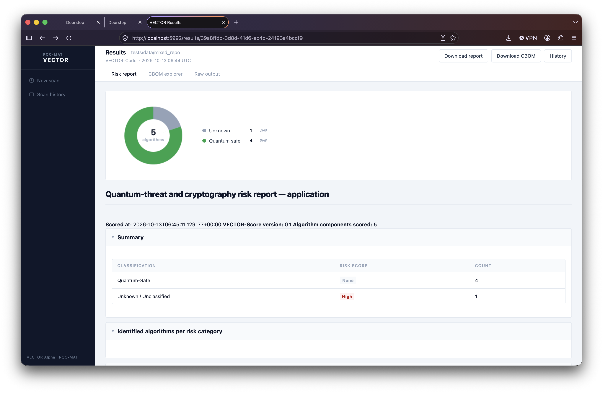
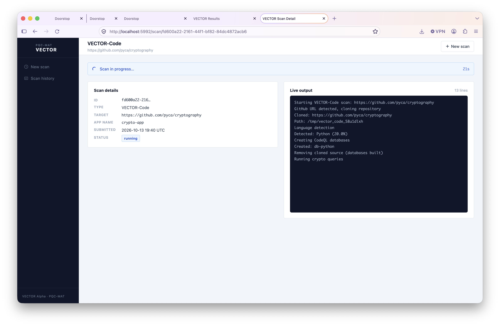
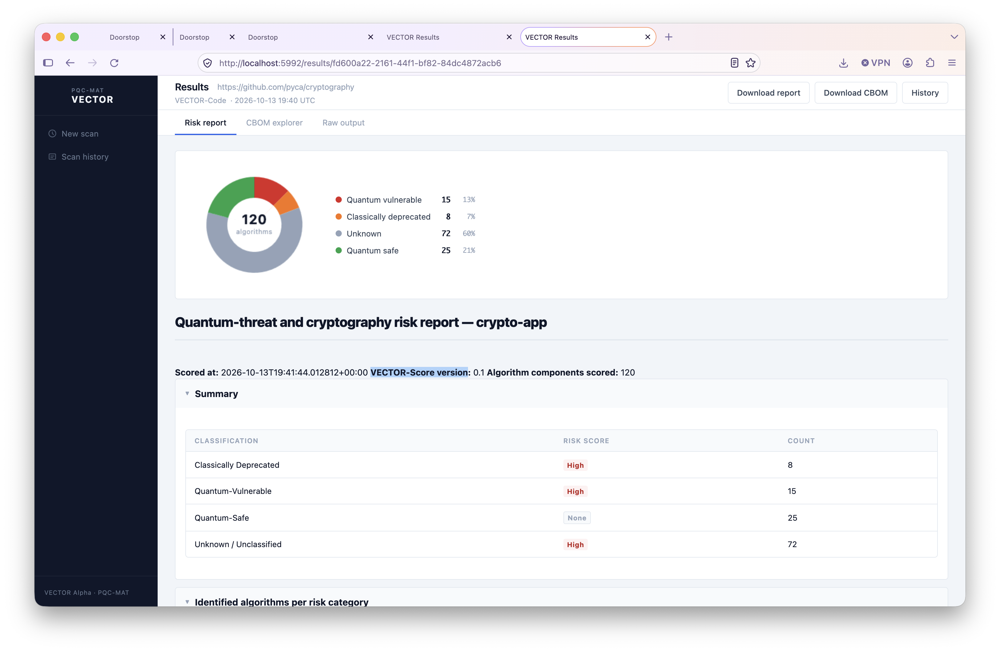
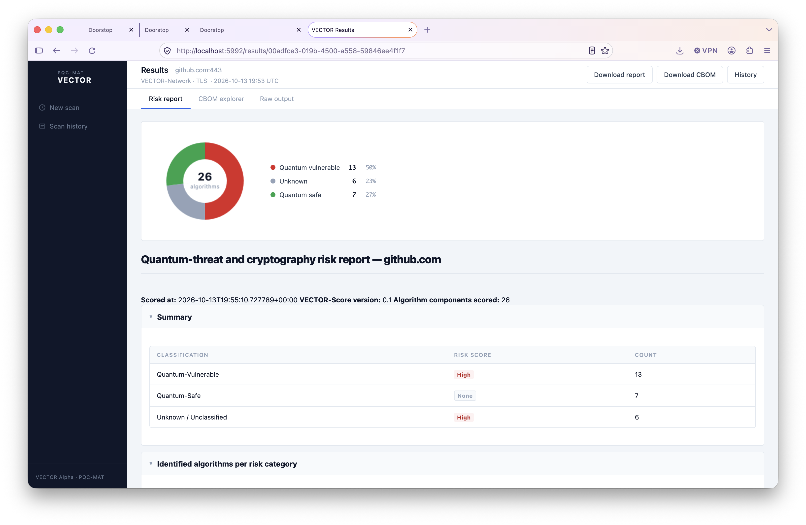
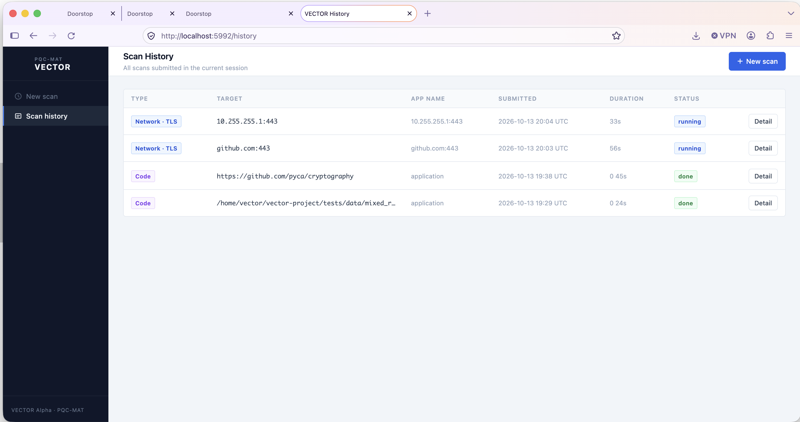

# Test report for the VECTOR web interface

## Relevant test environment and configuration details

- GUI started with `./vector.sh` in a GNU/Linux workstation

## Test execution results

1. The navigation sidebar shows exactly two items:

- ?c5-defect-0 - The navigation sidebar showed exactly two items: New scan, Scan history.

2. VECTOR-Code scan submission:

- ?c5-defect-0 - The inline error "Source path or GitHub URL is required" was shown and no scan was created.
- ?c5-defect-0 - The scan finished successfully with the expected output

{ width=80% }

- ?c5-defect-0 - GitHub URL source: the scan finished successfully and the application name `crypto-app` was shown in the progress page followed by the report.

{ width=80% }

{ width=80% }

3. VECTOR-Network scan submission:

- ?c5-defect-0 - Protocol defaulted to TLS and Port defaulted to `443`.
- ?c5-defect-0 - Port updated to `22` automatically on switching to SSH, and returned to `443` on switching back to TLS.
- ?c5-defect-0 - The inline error "Target is required" was shown.
- ?c5-defect-0 - The inline error "Port must be between 1 and 65535" was shown.
- ?c5-defect-0 - A new scan is created and the browser navigates automatically to a scan details page which shows the real-time CLI output.

{ width=80%}

4. Scan progress monitoring:

- ?c5-defect-0 - The scan's status and output updated on the page without a full page reload while running.
- ?c5-defect-0 - The second submission was accepted while the first was still running; both proceeded independently and the interface stayed responsive. The scan result fails.

{ width=80% }

5. Failure display:

- ?c5-defect-0 - The detail page displayed a specific error message describing the failure: `Error: testssl.sh exited with code 246 - target likely unreachable, refused the connection, or DNS resolution failed`
- ?c5-defect-0 - The detail page displayed a specific error message describing the failure: `Error: CBOM generation failed. Please check the source or network availability`
- ?c5-defect-0 - The detail page displayed a specific error message describing the failure: `Error: Path '/tmp/test' does not exist`

6. Scan history:

- ?c5-defect-0 - The history table included scan type, target, application name, submission timestamp, duration and status.
- ?c5-defect-0 - Every row, including the failed scan, linked to its scan detail page.
- ?c5-defect-0 - Only the completed ("done") row linked directly to a Results page; the failed scan did not.

7. Results:

- ?c5-defect-0 - The Risk report tab was shown by default in HTML format, with a visual summary of findings at the top.
- ?c5-defect-0 - A markdown file matching the content shown in the tab was downloaded.
- ?c5-defect-0 - The CBOM explorer showed distinct, structured components, one per algorithm found, not raw JSON. Each component showed variant name, primitive type, and a colour-coded risk classification badge.
- ?c5-defect-0 - The classification filter correctly isolates a single value and correctly shows all components when "All" is selected.
- ?c5-defect-0 - "Download CBOM" downloads a `.json` file containing the full annotated CBOM.
- ?c5-defect-0 - The Raw output tab showed the VECTOR-Network scan's raw output as collapsible JSON.
- ?c5-defect-0 - Steps 7.1-7.6 hold for VECTOR-Code scan results.

8. No step at any point displays a raw Python stack trace in the browser.

- ?c5-defect-0 - There were no raw Python stack trace in the browser.

### Defect summary description

Defect-free test execution, i.e., defect category: ?c5-defect-0

### Test execution evidence

See attached images and reported output.