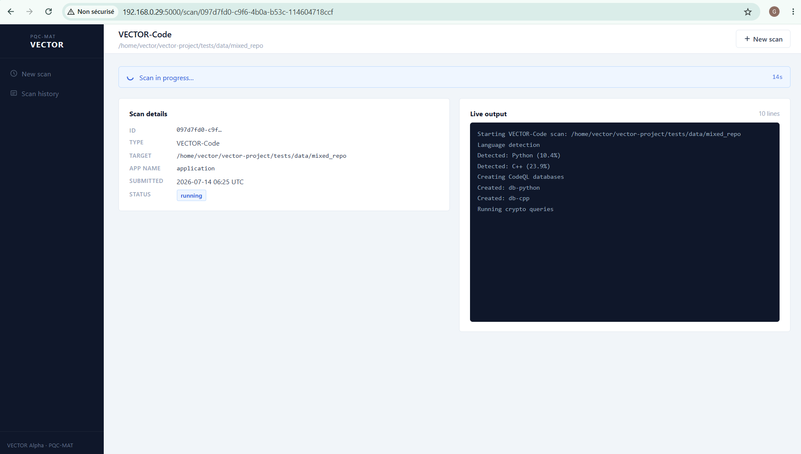
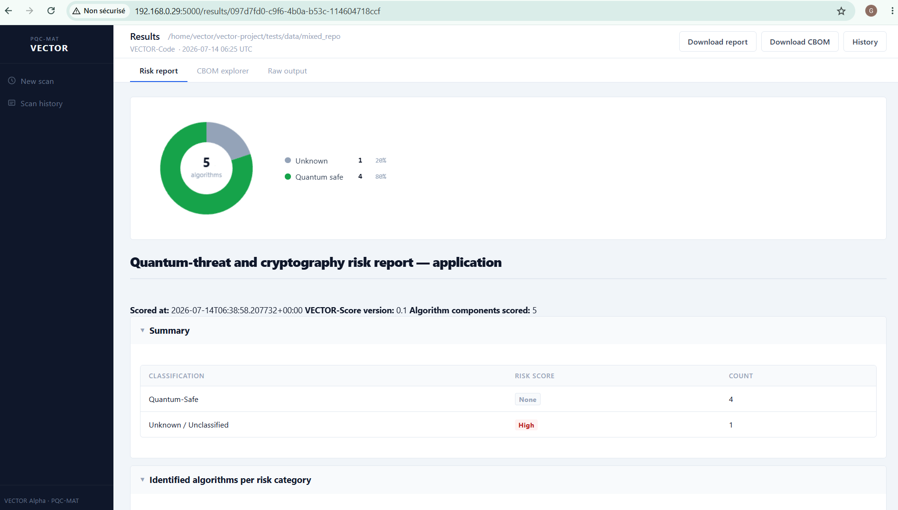
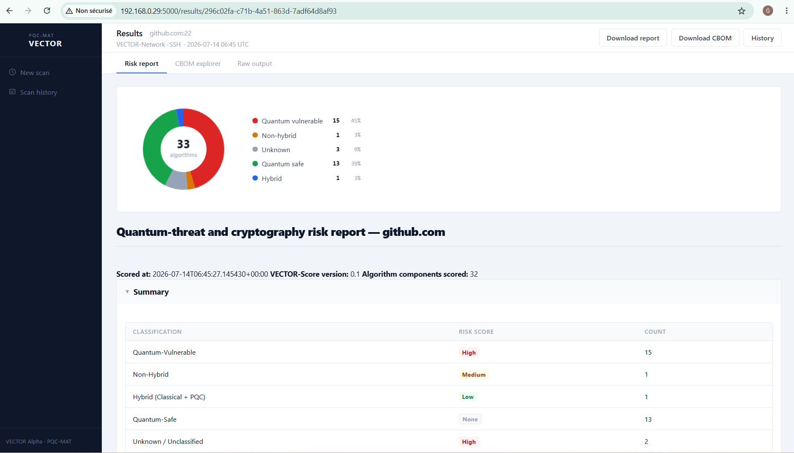
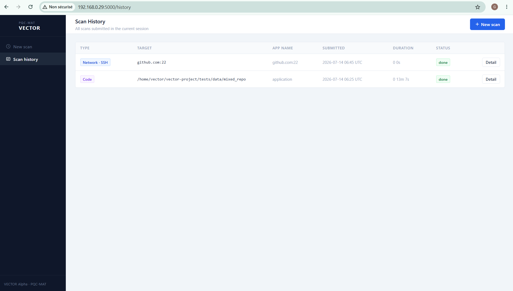
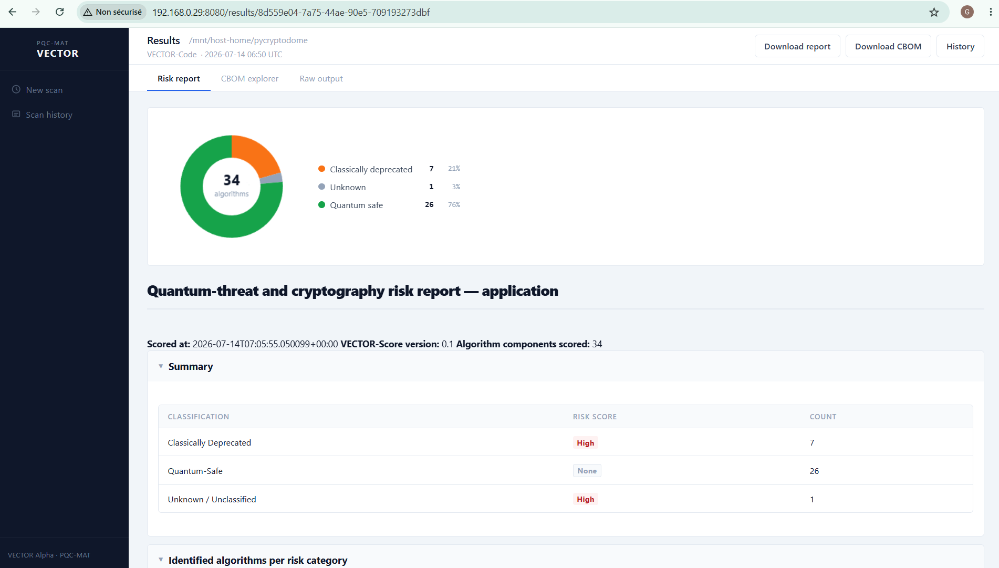

# Test report for VECTOR CLI and GUI runner script

## Relevant test environment and configuration details

- Environment is GNU/Linux workstation and Docker engine is running
- The script is executable
- The results directory is created
- The CRLF was eliminated

## Test execution results

**Step 1** — script help/dispatch:

- ?c5-defect-0 — verified that `help`, `-h`, and`--help` all print usage and exit `0` without any Docker call

**Step 2.1** — build when no image exists:

- ?c5-defect-0 — build was followed by the `vector` CLI help listing `code`, `network`, `score`, `gui`

**Step 2.2** — re-run does not rebuild:

- ?c5-defect-0 — printed only the `vector` CLI help listing `code`, `network`, `score`, `gui`

**Step 2.3** — `build` always rebuilds:

- ?c5-defect-0 — the image was rebuilt

**Step 2.4** — build failure stops before any container starts:

- ?c5-defect-0 — the expected error message was shown

**Step 3.1** — the GUI opened in the browser:

- ?c5-defect-0 — the GUI was operational according to `TCS-015`.

{ width=80% }

{ width=80% }

{ width=80% }

{ width=50% }

**Step 3.2.1 / 3.2.2** — mounted-directory scan (`pycryptodome` cloned to `/tmp`):

- ?c5-defect-0 — the GUI with port 8080 opened and inserted path was accepted. The scan finished successfully.

{ width=80% }

**Step 4.1** — `code tests/data/mixed_repo` via CLI:

- ?c5-defect-0 — the scan finished successfully

**Step 4.2** — `network --target github.com` via CLI:

- ?c5-defect-0 — the scan finished successfully

**Step 4.3** — `score` producing a risk report via CLI:

- ?c5-defect-0 — the risk report was generated successfully

**Step 4.4** — `code` against a GitHub URL via CLI:

- ?c5-defect-0 — the scan finished successfully

**Step 5.1 / 5.2 / 5.3** — invalid source, output, and CBOM paths:

- ?c5-defect-0 — the error messages were shown correctly

**Step 6** — no host-side Python/Poetry dependency:

- ?c5-defect-0 — confirmed by inspection, the script invokes `docker` and script only.

### Defect summary description

Defect-free test execution, i.e., defect category: ?c5-defect-0

## Guide

- Defect category: ?c5-defect-0; ?c5-defect-1; ?c5-defect-2; ?c5-defect-3; ?c5-defect-4
- Verification method (VM): Test (T), Review of design (R), Inspection (I), Analysis (A)