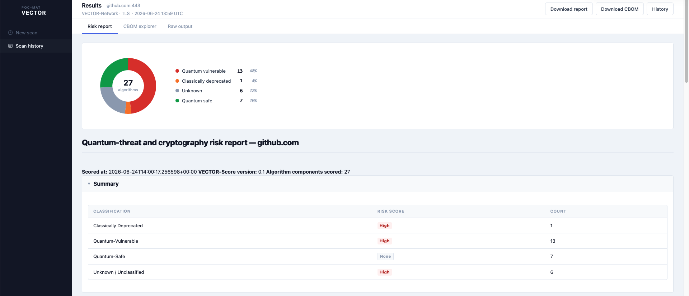
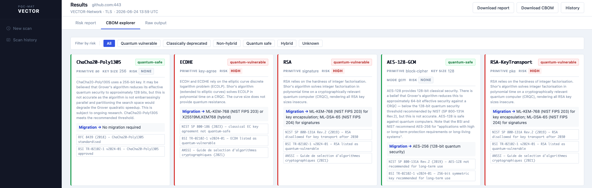

# TOR - Cryptographic Inventory Tools

TOR provides tools for cryptographic inventory, helping organizations identify cryptographic algorithms vulnerable to quantum attacks across source code and network infrastructure.

## Table of contents

- [Overview](#overview)
- [Getting started](#getting-started)
- [Usage](#usage)

## Overview

The project is divided into two complementary scanning components:

- **VECTOR-Code**: Analyzes source code to detect cryptographic algorithms using CodeQL
- **VECTOR-Network**: Scans network services (SSH, TLS) to identify cryptographic configurations

An additional component, **VECTOR-Score**, is used on the output of any or both of the components above, to assign a risk classification and a score to the inventorized cryptographic algorithms.

**VECTOR-GUI** provides a browser-based Flask interface that covers the full pipeline — scan submission, live output monitoring, and results browsing — without requiring the CLI.

## Getting Started

The project runs inside a VS Code Dev Container, which automatically installs all required dependencies and tools.

### Prerequisites

- [Docker](https://www.docker.com/) installed and running
- [VS Code](https://code.visualstudio.com/) with the [Dev Containers](https://marketplace.visualstudio.com/items?itemName=ms-vscode-remote.remote-containers) extension

### Setup

1. Open the project root folder in VS Code
2. When prompted, click "Reopen in Container", or run the command: `Dev Containers: Reopen in Container` (`Ctrl+Shift+P`)
3. Wait for the container to build 

The container automatically installs all required dependencies and tools:
- Python 3.11, Poetry, Go 1.25
- CodeQL CLI and CodeQL cryptographic queries
- testssl.sh, ZGrab2, cloc
- cryptobom-forge

## Usage

All commands are run from inside the Dev Container. For standalone container usage, see the [quick start guide](../docs/manual/start.md).

### VECTOR-Code

Analyzes source code to detect cryptographic API usage and produce a CBOM.

```bash
# Local path
vector code <path> [--name <app_name>] [--output <dir>]

# GitHub repository URL (no local checkout needed)
vector code https://github.com/<owner>/<repo> [--name <app_name>] [--output <dir>]
```

Quick test with the bundled test project:

```bash
vector code /home/vector/test-project/cryptography
```

See [VECTOR-Code reference](../docs/manual/vector-code.md) for arguments, output structure, and language support.

### VECTOR-Network

Scans SSH or TLS services to enumerate cryptographic configurations and produce a CBOM.

```bash
vector network --protocol tls --target example.com --port 443 --output results
vector network --protocol ssh --target github.com --port 22 --output results
```

See [VECTOR-Network reference](../docs/manual/vector-network.md) for output file naming and TLS/SSH field coverage.

### VECTOR-Score

Classifies each algorithm in a CycloneDX CBOM by quantum risk posture and produces a Markdown risk report.

```bash
vector score <cbom.json> [--output <path>] [--report <path>] [--no-report]
```

See [VECTOR-Score reference](../docs/manual/vector-score.md) for risk classifications and output format.

## Known Limitations

- **x86_64 only**: The Dev Container uses the CodeQL CLI which is only available for x86_64. GitHub does not provide ARM64.

## VECTOR-GUI: web interface

Browser-based interface for scan submission, live monitoring, and results browsing.

```bash
vector gui            # default port 5992
vector gui --port 8080  # custom port
```

Forward the port in the VS Code **Ports** panel, then open `http://localhost:<port>`.

The interface provides three result views for each completed scan: a **risk report** with a quantum risk distribution chart and per-classification summary, a **CBOM explorer** with filterable per-algorithm risk cards and migration guidance, and a **raw output** tab with the original scanner output. Past scans are accessible from the **scan history** page.





See [VECTOR-GUI quick start](../docs/manual/start.md#web-interface) for usage details.

## Documentation

Full user manual: [`docs/manual/`](../docs/manual/README.md) 
